[简体中文](./README.zh-CN.md) · [Website](https://excise.lei6393.com) · [GitHub](https://github.com/SuperMarioYL/excise)

<picture>
  <source media="(max-width: 600px) and (prefers-color-scheme: dark)" srcset="./assets/presentation/hero-mobile-dark.svg">
  <source media="(max-width: 600px)" srcset="./assets/presentation/hero-mobile-light.svg">
  <source media="(prefers-color-scheme: dark)" srcset="./assets/presentation/hero-dark.svg">
  
</picture>

# Excise

**Remove selected transcript turns with a visible diff.**

Excise lists and edits supported coding-agent transcripts, preserving stable turn IDs and tool-call relationships while exposing the proposed cut before writing.

## Why use it

A failed detour can consume context while the rest of a session remains useful. Select the specific turns, inspect dependency warnings and retain a snapshot when changing an existing supported transcript.

- **Keep the useful turns** — Select a range instead of discarding the entire session.
- **Inspect before writing** — Dry-run shows the proposed transcript diff.
- **Keep recoverable edits** — Existing write targets get a compressed snapshot.

## Architecture

<picture>
  <source media="(max-width: 600px) and (prefers-color-scheme: dark)" srcset="./assets/presentation/architecture-mobile-dark.svg">
  <source media="(max-width: 600px)" srcset="./assets/presentation/architecture-mobile-light.svg">
  <source media="(prefers-color-scheme: dark)" srcset="./assets/presentation/architecture-dark.svg">
  
</picture>

Format loaders produce a shared turn model. Heuristics rank removal candidates; optional model reranking refines the shortlist. The dependency graph checks selected turns, the TUI or cut command presents a diff, and writers apply changes with snapshot and edit-log support.

| Component | Responsibility |
| --- | --- |
| `Transcript loaders` | internal/session |
| `Suggestions + rerank` | internal/suggest; internal/llm |
| `Dependency graph` | internal/session/dependency.go |
| `Diff + write` | internal/tui; session/writer.go |
| `Snapshots` | internal/safety |

## Install and quickstart

Use the runtime version declared in the repository manifest. The source installation below makes the included example reproducible.

```bash
git clone https://github.com/SuperMarioYL/excise.git
cd excise
go build ./cmd/excise
```

Python 3 drives a dry-run cut of turn 5 in the included transcript and verifies its SHA256 is unchanged.

```bash
python3 examples/presentation_demo.py
```

## Recorded demo

<picture>
  <source media="(max-width: 600px) and (prefers-color-scheme: dark)" srcset="./assets/presentation/process-mobile-dark.svg">
  <source media="(max-width: 600px)" srcset="./assets/presentation/process-mobile-light.svg">
  <source media="(prefers-color-scheme: dark)" srcset="./assets/presentation/process-dark.svg">
  
</picture>

The cut preview selects the fifth turn and leaves the input file byte-identical.

```text
Will remove 1 turn(s) (including 0 pulled in by tool-call dependency):
  - u-0003  [user] ~6t  Thanks, that is great.
dry-run; no files written
source unchanged: True
```

The complete command and output are recorded in [docs/demo-results.json](./docs/demo-results.json). Inputs and reproduction code are included in the repository.


The existing recording is retained for context; the text example above documents the reproducible scenario.

## Usage

Run these commands from the repository root after installation. Replace paths for your own data.

```bash
go run ./cmd/excise list testdata/claude_session_simple.jsonl
go run ./cmd/excise suggest testdata/claude_session_polluted.jsonl --json
go run ./cmd/excise cut 5 testdata/claude_session_simple.jsonl --dry-run
# Interactive review of your own file:
go run ./cmd/excise pick session.jsonl
```

## Configuration

--tool selects auto, claude or cursor. cut uses 1-based ranges such as 5-7,9; --dry-run prints the diff, --yes accepts a real write, and --force overrides dependency warnings. Snapshots live in ~/.excise and are pruned after 30 days on a later snapshot write. rollback --list lists IDs; rollback ID --to path selects a destination explicitly. Optional excise.toml is loaded from the project or XDG config, with [llm] backend, model, host, top_n, timeout_sec, provider and api_key_env.

## Integrations and responsibilities

<picture>
  <source media="(max-width: 600px) and (prefers-color-scheme: dark)" srcset="./assets/presentation/integrations-mobile-dark.svg">
  <source media="(max-width: 600px)" srcset="./assets/presentation/integrations-mobile-light.svg">
  <source media="(prefers-color-scheme: dark)" srcset="./assets/presentation/integrations-dark.svg">
  
</picture>

Choose the input and output route that matches your workflow. The local example below exercises the stated subset.

| Route | Implemented role |
| --- | --- |
| Claude Code JSONL | Read and rewrite supported records |
| Cursor JSONL / SQLite | SQLite writes an excised sidecar |
| TUI / range CLI | Interactive or explicit selection |
| Ollama / remote API | Opt-in shortlist reranking |
| Gzip snapshots | Rollback for an existing write target |

## Limits and next steps

- The demo is dry-run only and confirms the original bytes stay unchanged. It does not test a running agent reloading the file.
- Cursor SQLite editing writes a .excised.jsonl sidecar rather than changing the live database. The first sidecar has no previous version to restore.
- Model reranking is opt-in and can send transcript excerpts to the configured endpoint. Heuristic suggestions are review candidates, not proof that a turn is useless.

More transcript adapters and broader end-to-end compatibility checks are future directions; retain a representative fixture when reporting a format mismatch.

## License and contributions

See [LICENSE](./LICENSE). When reporting an issue, include a minimal input, the command, and the observed output.
